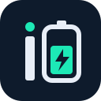
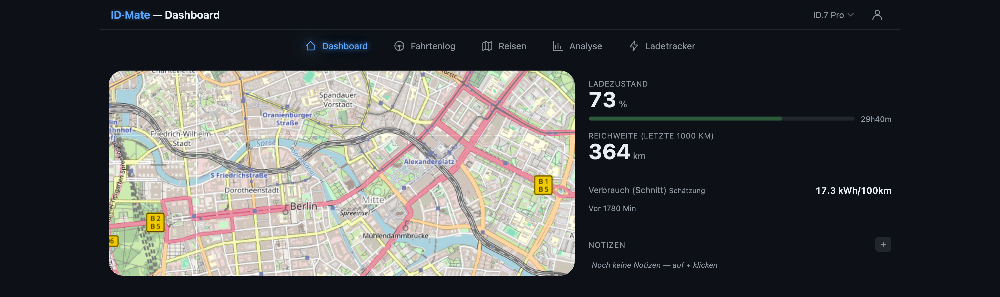

# IDmate



**Self-hosted telemetry, trip log and charge tracker for EVs without a vendor API.**

IDmate reads the car directly over OBD2/CAN with the [IDTelemetry](https://github.com/IDmate-app/IDTelemetry) ESP32 stick (MQTT, AES-256 encrypted), takes wallbox data from Home Assistant and keeps everything on your own server: InfluxDB for telemetry, SQLite for trips and charges. Think TeslaMate, but for the VW ID family and other CAN-readable EVs.



## Features

**Driving**
- 🚗 Live dashboard: map, SoC, range, charging state
- 🛣️ Automatic trip detection, also across telemetry gaps
- 📒 Trip log with purpose, destination, notes, tags, batch edit, CSV export
- 📄 Monthly logbook as PDF (business / private)
- 🗺️ Journeys: trips + charges of a holiday on one map, GPX export, live sharing with guests
- 📍 Geofences (circle or polygon) with icons, auto-suggested from frequent places

**Charging**
- 🔌 Wallbox sessions from 15-min meter readings (Home Assistant), shared meter for several cars
- ⚡ External / DC charges, entered by hand or read from a receipt screenshot (OCR)
- 🧾 Monthly billing print with flat rate or dynamic tariff, reconciled against the meter
- 🔍 Gap editor for missing readings and missing trips

**Battery & vehicle**
- 🔋 Own capacity measurement (energy counter ÷ SoC), not the BMS estimate
- 📉 State of health with trend, per battery (swaps supported)
- 🧪 Buffer watch: rest voltage at a given SoC over the months
- 📜 Vehicle report: battery, consumption, charging, mileage, data quality — as PDF
- 📊 Analysis: trips, purposes, efficiency vs. temperature, charging, heatmap

**Operations**
- 👥 Multi-user, multi-vehicle, per-user vehicle visibility
- 🔐 Passkeys, TOTP 2FA, no default credentials
- 📥 Import from TeslaMate and GPX
- 🩺 Diagnostics page with checks and a ZIP export for troubleshooting
- 🌍 German and English, dark and light theme, installable as PWA

## Quick start

```bash
git clone https://github.com/IDmate-app/IDMate.git && cd IDMate
cp .env.example .env && nano .env
docker compose up -d
```

Open `http://your-host:3004/setup` to create the admin account.

## Documentation

| | |
|---|---|
| [Installation](docs/installation.md) | Docker / Portainer, environment variables, updates, backup |
| [Setup guide](docs/HOW-TO-SETUP.md) | MQTT, port forwarding, remote access, first vehicle |
| [User manual](docs/manual.md) | Every page and what it does |
| [Home Assistant](docs/home-assistant.md) | Wallbox readings via webhook |
| [TeslaMate import](docs/teslamate-import.md) | Bring your history over |
| [Architecture](docs/architecture.md) | Components, data format, project layout, development |
| [FAQ](docs/faq.md) | Common questions |

## License

GNU AGPL v3.0 — see [LICENSE](LICENSE). A hobby project, no warranty.

[](https://ko-fi.com/lordvonbaum)
