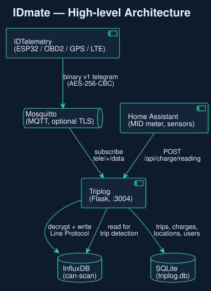
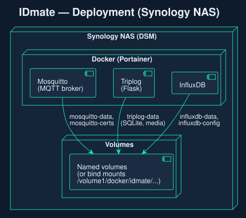
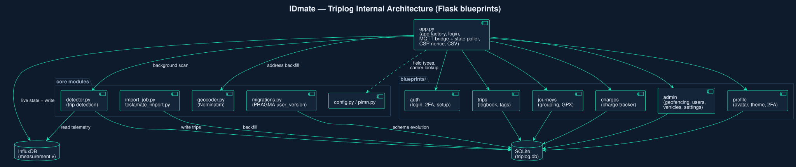

# Architecture

[← README](../README.md)



| Component | Role |
|---|---|
| IDTelemetry stick | reads CAN/OBD2, sends a telegram about every 10 s over MQTT |
| Mosquitto | MQTT broker (optional TLS) |
| Triplog | Flask web app: decodes telegrams, writes InfluxDB, detects trips, everything in the UI |
| InfluxDB | time series (10 s telemetry) |
| SQLite | trips, charges, vehicles, users, settings |
| Home Assistant | wallbox meter readings via webhook |



## Inside Triplog



- `app.py` — core: MQTT → InfluxDB bridge, live state, capacity model glue, CSV
- `blueprints/` — `auth`, `passkeys`, `trips`, `journeys`, `share`, `charges`, `admin`, `profile`, `model`, `report`, `diagnostics`
- `detector.py` — trip and charge detection
- `fahrzeugmodell.py` — vehicle model: capacity per battery, SoC profile, efficiency, energy book, consumption rule, buffer watch ([notes, German](fahrzeugmodell.md))
- `beleg.py` — receipt OCR
- `migrations.py` — versioned SQLite migrations (`PRAGMA user_version`), run on start
- `lang/` — `de.json`, `en.json`

## Telegram format

Topic `tele/<device>/data`, payload AES-256-CBC (PKCS7), random IV per message:

```text
[1 byte version][16 byte IV][ciphertext]
```

Plaintext: a `u32` field mask (bit n = field n present), then the present fields in fixed order. Version `0x02` widens the energy counter `kw` to `u32`. Wrong keys are dropped silently.

Short field names in InfluxDB: `s` SoC, `u` HV voltage, `i` current, `p` power, `v` speed, `bt` battery temperature, `et` outside temperature, `ca` BMS capacity, `kw` energy counter, `la`/`lo` position, `od` odometer.

## Project layout

```text
IDMate/
├── docker-compose.yml
├── .env.example
├── docs/                 # this documentation, diagrams, screenshots
├── homeassistant/        # HA automations
├── mosquitto/            # broker config
└── triplog/
    ├── app.py, detector.py, fahrzeugmodell.py, beleg.py, migrations.py, …
    ├── blueprints/
    ├── templates/, static/, lang/
    └── tests/
```

## Development

```bash
cd triplog
python -m venv .venv && . .venv/bin/activate
pip install -r requirements.txt -r requirements-dev.txt
SECRET_KEY=test python -m pytest tests/ -q
```

CI runs the tests and a boot smoke test before the images are built and pushed to ghcr.io. Schema changes always go through a migration.

Diagrams: PlantUML sources in [diagrams/](diagrams/), render with `plantuml -tsvg docs/diagrams/*.puml`.

Developed human-in-the-loop with AI assistance; all decisions were made by the maintainer.
