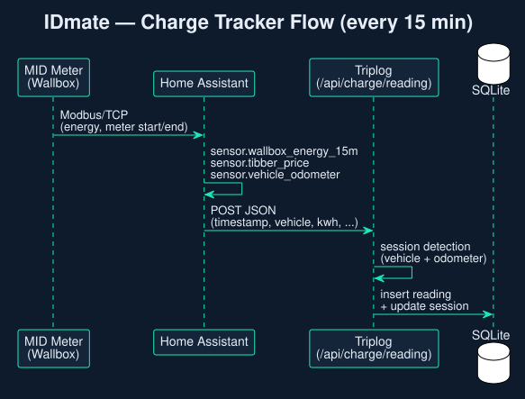

# Home Assistant

[← README](../README.md)

Home Assistant sends the wallbox meter readings to IDmate every 15 minutes. IDmate turns them into charge sessions with energy and cost.



Ready-made files: [homeassistant/](../homeassistant/) — `idmate_charge_tracker.yaml` (wallbox readings) and `idmate_vehicle_telemetry.yaml` (vehicle data from a manufacturer integration, for cars without the stick).

## Wallbox readings

**1. REST command** in `configuration.yaml`:

```yaml
rest_command:
  idmate_charge_reading:
    url: "http://192.168.x.y:3004/api/charge/reading"
    method: POST
    headers:
      Content-Type: application/json
      Authorization: "Bearer {{ states('input_text.idmate_token') }}"
    payload: >-
      {
        "timestamp": "{{ now().strftime('%Y-%m-%d %H:%M') }}",
        "vehicle": "{{ states('input_select.wallbox_vehicle') }}",
        "kwh": {{ states('sensor.wallbox_energy_15m') | float(0) }},
        "meter_start": {{ states('sensor.wallbox_meter_start') | float(0) }},
        "meter_end": {{ states('sensor.wallbox_meter_end') | float(0) }},
        "tibber_price": {{ states('sensor.tibber_price') | float(0) }},
        "tibber_grundgebuehr": {{ states('sensor.tibber_grundgebuehr_15m') | float(0) }},
        "odometer": {{ states('sensor.vehicle_odometer') | float(0) }}
      }
```

**2. Automation:**

```yaml
automation:
  - alias: "IDmate send charge data"
    trigger:
      - platform: time_pattern
        minutes: "/15"
    condition:
      - condition: numeric_state
        entity_id: sensor.wallbox_energy_15m
        above: 0
    action:
      - service: rest_command.idmate_charge_reading
```

Adapt the entity IDs to your installation.

## Notes

- `vehicle` is the plate as set in IDmate. `OFF` / `unknown` is fine: IDmate assigns the reading to the car that was plugged in.
- `meter_start` / `meter_end` come from a calibrated (MID) meter, e.g. via Modbus. They let IDmate find missing and double-counted energy.
- Set `CHARGE_WEBHOOK_TOKEN` in `.env` as soon as the webhook is reachable from outside.
- Resent readings (lost response) are recognised and not counted twice.

## Vehicles as HA sensors

Settings → Home Assistant serves the latest values of selected vehicles over a token-protected API. The "IDMate Telemetry" Home Assistant integration reads them with the base URL and the token.
