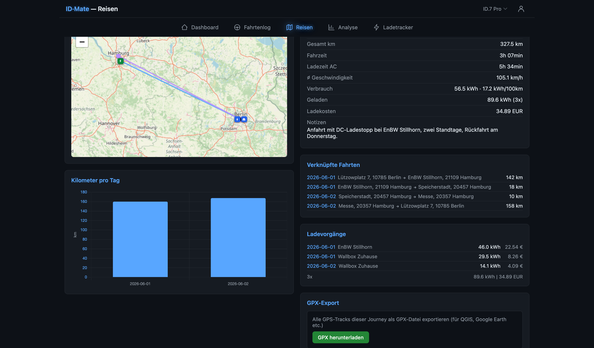
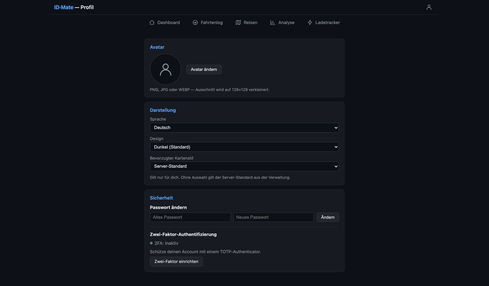

# User manual

[← README](../README.md)

A short tour of every page. The vehicle in the header is the active one; most pages show its data.

- [Dashboard](#dashboard)
- [Trip log](#trip-log)
- [Journeys](#journeys)
- [Charge tracker](#charge-tracker)
- [Analysis](#analysis)
- [Settings](#settings)
- [Profile](#profile)

## Dashboard

Live map with heading, SoC, range (from your recent consumption), charging state and the last trip. Updates every few seconds while the car is awake.

## Trip log

- Trips are detected automatically from the telemetry (stops, telemetry gaps, a charge in between).
- Set purpose, destination, reason and notes per trip or for many at once.
- Geofences fill in the destination; **route rules** can set the purpose (e.g. home → office = business).
- **Merge** two trips or **split** one at a stop.
- **Visits** view: when you were away from home and how long on site.
- Export as CSV or as a monthly **logbook PDF** (business trips in detail, private trips summarised).
- A red asterisk marks trips filled in by hand that look implausible (speed, consumption, overlaps).

## Journeys

- Group the trips of a holiday or tour; trips in the date range join by themselves.
- One map, all charges on the way, consumption and cost, GPX export.
- **Share live:** a link plus a four-digit code for guests; they see only the track and the car.

## Charge tracker

**Wallbox charges** come from 15-minute meter readings (see [Home Assistant](home-assistant.md)). Readings are grouped into one session per plug-in; a session is split only if the car was driven in between. Several cars on one meter are fine.

**External charges** (DC, public AC):
- detected automatically from a SoC rise between two trips,
- or entered by hand,
- or read from a **receipt screenshot**: kWh, cost, start, end and operator are recognised (OCR) and pre-filled.

The operator comes from the charge location (geofence) first, then from the receipt.

**Print / billing:** a monthly statement for your employer with flat rate or dynamic tariff. It is checked against the meter: if energy is missing or counted twice, printing is blocked until it is fixed. Mark a month as billed to freeze it.

**Gaps** (Settings → Gaps): missing meter energy, with an editor to fill it in. Duplicate readings are removed under Settings → Charges.

## Analysis

All tabs use the date range at the top.

| Tab | Shows |
|---|---|
| Trips | distance, time, consumption per month, heatmap |
| Trip purposes | business vs. private, by purpose |
| Battery | SoC, energy per trip, range, **state of health** (own measurement, median, trend) next to what the BMS reports |
| Efficiency | consumption vs. temperature and speed |
| Charging | home vs. external, AC/DC, operators, cost |
| World map | everywhere you have driven |
| Vehicle | **vehicle report** for the whole history, as PDF |

### Vehicle report

A one-page certificate of the car:

- **Battery:** usable capacity and SoH with its spread, trend per year, battery swaps, BMS value for comparison, buffer watch.
- **Consumption:** battery side and grid side (with charging losses), last 12 months, per season, per month with outside temperature, consumption at 20 °C, recuperation.
- **Charging:** home/external, AC/DC, measured charging efficiency, usual SoC window, average price.
- **Mileage** and **data quality** with an "IDmate check" score (energy recorded, odometer complete, no findings).
- Footer with date, version and a check code.

### How the battery is measured

- **Capacity** = energy the car's counter saw going into the battery ÷ SoC gain, per charge. Without a counter: metered kWh × charging efficiency ÷ SoC gain.
- A **SoC profile** per car corrects that 1 % of SoC is not the same energy everywhere.
- **DC charges** are put on the AC level (cell losses at high current).
- One fit per battery: a swap never bends the line of the old one.
- **Buffer watch:** if the car opened its hidden buffer, the usable energy would stay the same, but the rest voltage at a displayed SoC would move. IDmate tracks it per month.

## Settings

| Tab | For |
|---|---|
| Logbook | trip values (purposes, destinations, reasons): rename, merge, delete |
| Geofencing | places and charge locations (radius or polygon), operators, icons, suggestions from frequent stops |
| Routes | rules that set the trip purpose |
| Vehicles | plate, device, capacity; **battery swaps**; charging efficiency (measured or fixed) |
| Users | accounts, admin role, which vehicles each user sees |
| Charges | flat rate, billed-until lock, rebuild sessions, remove duplicate readings |
| Gaps | missing meter energy: backfill and edit |
| Import | trips and charges from CSV, GPX tracks, TeslaMate |
| Telemetry | stick battery, data volume, mobile carrier coverage |
| Home Assistant | serve vehicle values to Home Assistant |
| Database / Diagnostics | maintenance, health checks, log, ZIP export for troubleshooting |
| Settings | rescan trips, language, map style |

## Profile

Avatar, language, theme, map style, password, **passkeys** (Face ID / Touch ID) and TOTP 2FA with recovery codes.
